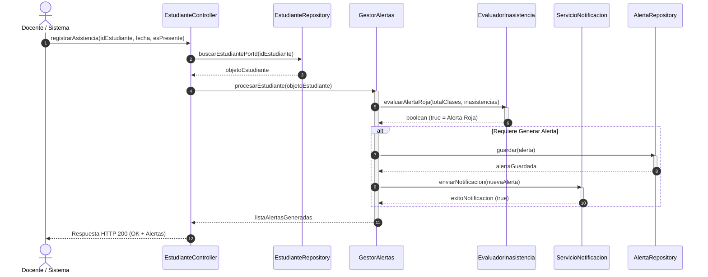

# Diagrama de Secuencia - SATE-UNIAJC

Este diagrama modela el intercambio dinámico de mensajes para el registro de asistencia y la evaluación automática de alertas, incluyendo el guardado en la base de datos.

