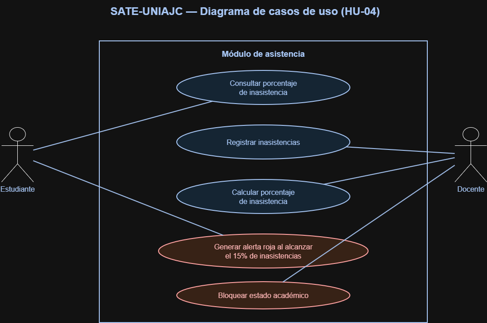
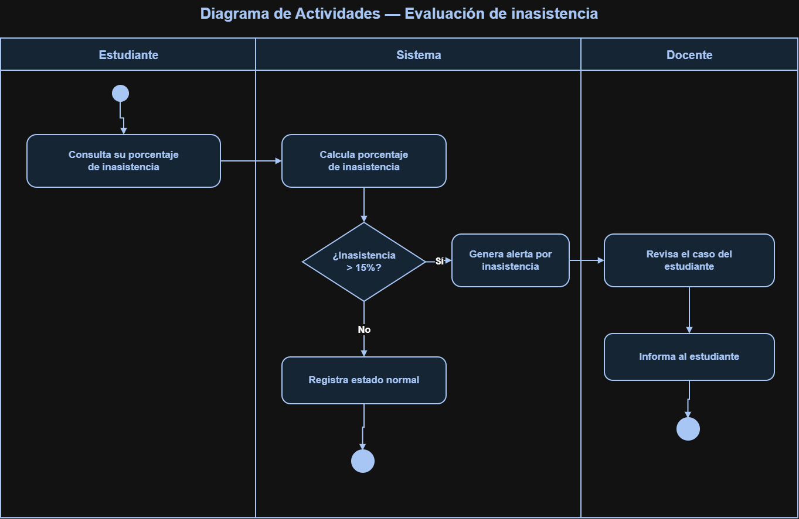

 Avances de Diseño Estático - Casos de Uso SATE-UNIAJC

Este archivo consolida los artefactos de diseño correspondientes al Módulo de Alertas Tempranas (Sprint 2).

 1. Diagramas de Casos de Uso y Actividades

 2. Historias de Usuario Consolidadas (Módulo de Alertas)
* **HU-04:** Registro Automatizado de Asistencia Estudiantil.
* **HU-05:** Generación de Alerta Amarilla por Promedio Académico Insuficiente (< 3.0).
* **HU-06:** Generación de Alerta Roja por Inasistencia Crítica (> 15%).
* **HU-07:** Persistencia y Creación de la Entidad Alerta en el Sistema.
