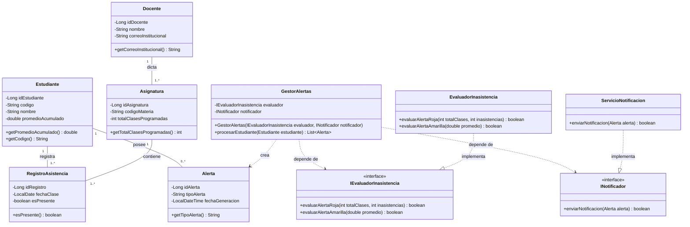

# Diagrama de Clases UML - SATE-UNIAJC

Plano técnico del Módulo de Alertas Tempranas (Corte II).

## Principios SOLID aplicados

- **SRP:** `EvaluadorInasistencia` solo calcula las reglas de negocio; `ServicioNotificacion` solo envía notificaciones; `GestorAlertas` solo coordina el flujo.
- **DIP:** `GestorAlertas` depende de las interfaces `IEvaluadorInasistencia` e `INotificador`, no de clases concretas. Las dependencias se inyectan por constructor.

